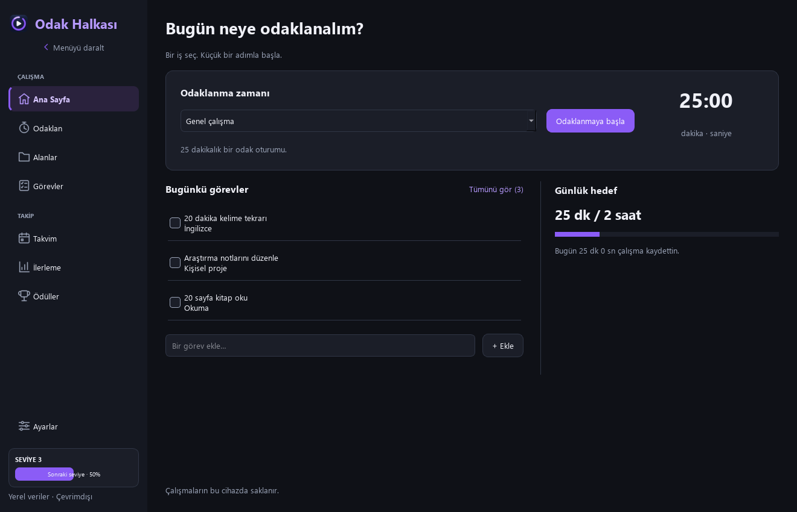
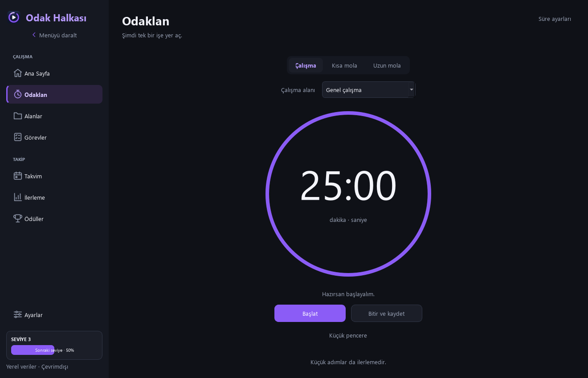
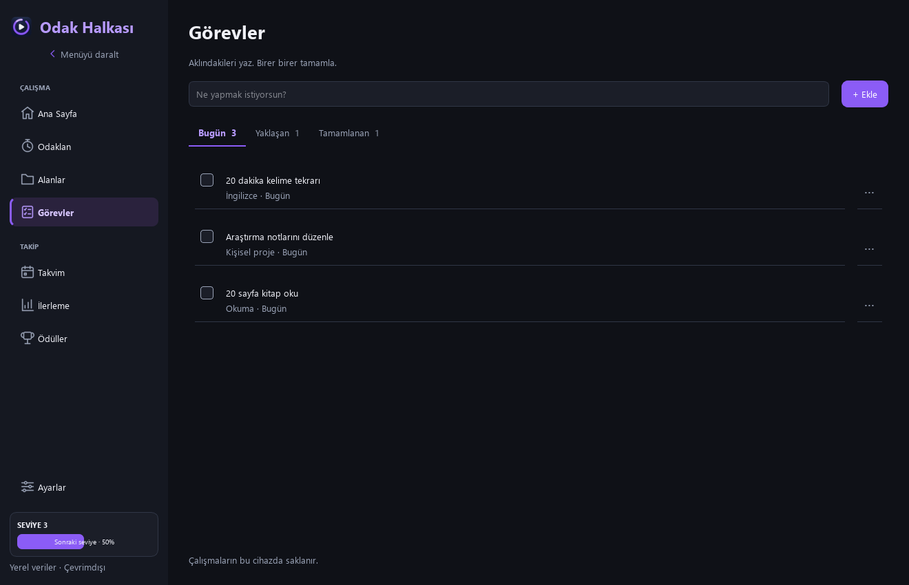
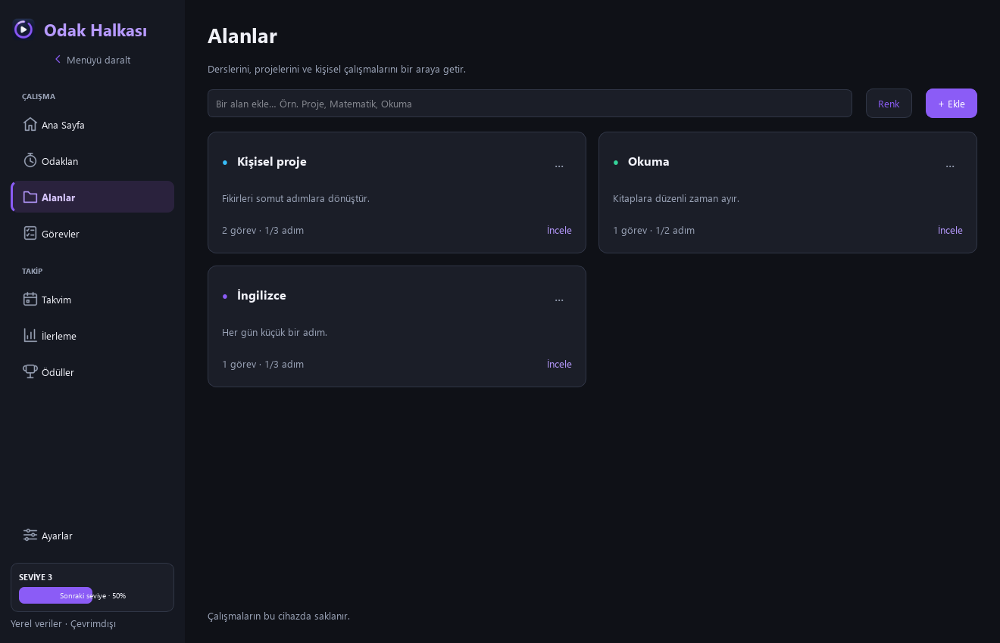
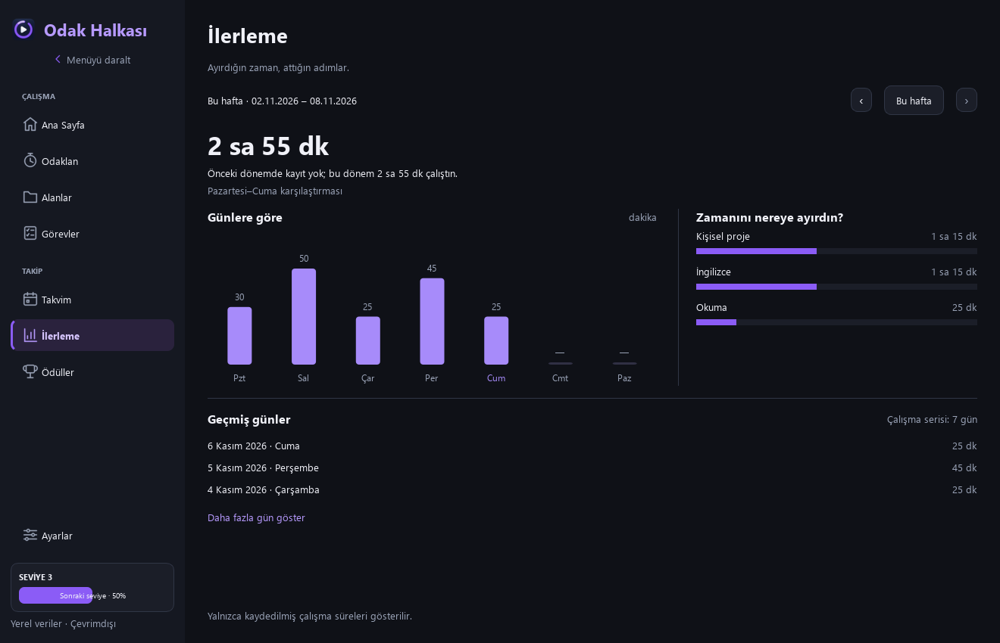
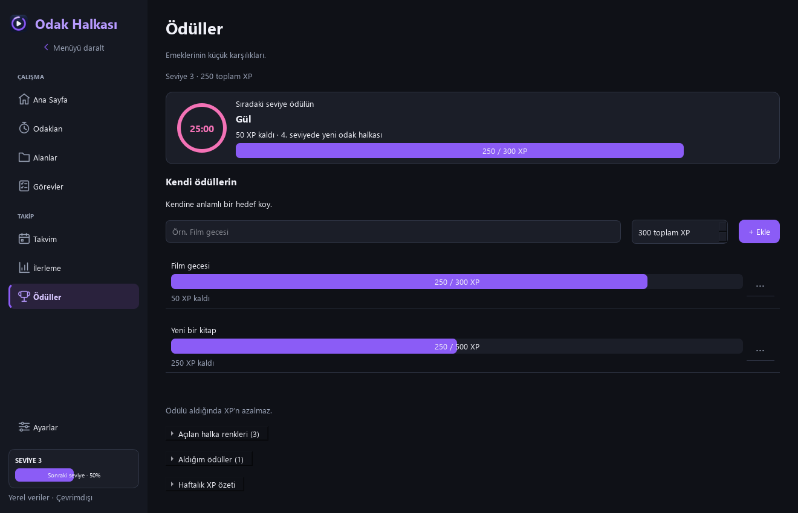

# Odak Halkası

**Odaklan, işlerini düzenle ve ilerlemeni takip et.**

Odak Halkası; ders, iş, proje ve kişisel çalışmalar için ücretsiz, Türkçe ve çevrimdışı çalışan bir Windows uygulamasıdır. Pomodoro sayacı, görevler, takvim ve çalışma geçmişi tek yerde bulunur.

## İndir

**İlk deneme sürümü: 0.1.0 Beta · Windows 10/11 x64**

[**Windows kurulumunu indir**](https://github.com/yasopaso/odak-halkasi-releases/releases/download/v0.1.0-beta.1/OdakHalkasi-Setup-0.1.0-beta.1-x64.exe) · [Sürüm sayfası ve SHA256](https://github.com/yasopaso/odak-halkasi-releases/releases/tag/v0.1.0-beta.1)

Bu deponun **Releases / Sürümler** bölümünde `v0.1.0-beta.1` sürümünü açın. Kurulum için **`OdakHalkasi-Setup-0.1.0-beta.1-x64.exe`** dosyasını indirin. Yaklaşık 34 MB boyutundadır; Python kurmanız gerekmez.

1. Kurulum dosyasını açın ve Türkçe kurulum adımlarını izleyin.
2. İsterseniz masaüstü kısayolu oluşturun.
3. Odak Halkası’u açın; kısa tanıtımı izleyin veya atlayın.
4. Bir çalışma alanı seçip **Odaklanmaya başla** düğmesine basın.

Kurulum yönetici izni istemez. Uygulamayı kullanmak için hesap, abonelik veya internet bağlantısı gerekmez. Kurulum dosyası henüz dijital olarak imzalı değildir; Windows yayınevi uyarısı gösterebilir. Dosya doğrulaması için sürümle birlikte `SHA256SUMS.txt` verilir.

## Neler yapabilirsin?

| Bölüm | Kullanım |
| --- | --- |
| **Ana Sayfa** | Çalışmaya başla, bugünkü görevlerini ve günlük hedefini gör. |
| **Odaklan** | Çalışma/mola sayacını başlat, duraklat, devam ettir veya erken kaydet. |
| **Alanlar** | Derslerini, işlerini ve projelerini kartlarla düzenle; her alana adımlar ekle. |
| **Görevler** | Bir görev yazıp Enter’a bas; bitirince kutusunu işaretle. |
| **Takvim** | Etkinliklerini ve tarihli görevlerini aynı yerde gör. |
| **İlerleme** | Haftalık süreyi, alanlara ayırdığın zamanı ve çalışma serini takip et. |
| **Ödüller** | Yeni halka renkleri aç ve kendine kişisel ödüller belirle. |
| **Ayarlar** | Süreleri, hedefi, görünümü, ses/bildirimleri ve yedeklerini yönet. |

### Çalışırken uygulama arkada kalsın

Bağımsız küçük pencere kalan süreyi, duraklat/devam et ve bitir düğmelerini gösterir. Ana pencere küçültülmüşken de kullanılabilir.

### Planını sade tut

Görevler Bugün, Yaklaşan ve Tamamlanan sekmelerinde bulunur. Alan kartları ders, proje veya kişisel çalışma olarak kullanılabilir.

### İlerlemeni gör, kendini ödüllendir

Kaydedilen her tam 75 saniyelik çalışma 1 XP kazandırır. Erken bitirdiğin çalışmalar da bu kuralla XP verir. Seviye yükseldikçe 18 halka rengi açılır. Kendi ödüllerini almak XP’ni azaltmaz.

Ekran görüntülerindeki çalışma kayıtları ve görevler örnek verilerdir.

## Verilerim nerede?

Veriler bilgisayarındaki `%LOCALAPPDATA%\StudyFlow\studyflow.db` dosyasında saklanır. Ayarlar → Veriler ve yedekleme bölümünden yedek alabilir veya geri yükleyebilirsin. Güncellemeden önce uygulamayı kapatman gerekir. Kaldırıp yeniden kurmak kişisel verileri silmez.

Bir oturumu kapatırken **Sonra devam et** seçersen, yeniden açılışta duraklatılmış olarak kurtarılır. Bilgisayar kapalıyken geçen süre eklenmez. Ani kapanmada son otomatik kayıttan sonraki yaklaşık 5 saniye kaybolabilir.

## Beta hakkında

Bu ilk deneme sürümüdür; geri bildirimlerle geliştirilecektir.

- Otomatik testler ile kurulum, güncelleme ve kaldırıp yeniden kurmada veri koruma kontrolleri yapıldı.
- Gerçek 25 dakika çalışma, 30 saniye duraklama, 5 dakika mola ve yeniden açılışta kurtarma akışı ayrı Windows test penceresinde doğrulandı.
- Bilgisayarı tamamen kapatıp açtıktan sonra oturumun duraklatılmış kurtarılması kullanıcı tarafından gözlemlendi.
- Uykuya geçişte otomatik duraklatma ve uyanınca “Devam et”i bekleme, otomatik kontroller ve kullanıcı denemesiyle doğrulandı. Toplam 91 otomatik test geçti.
- **Başka/temiz Windows ortamında kurulum testi henüz tamamlanmadı.**

## Geri bildirim

Bu deponun **Issues → New issue** bölümündeki **Hata bildirimi** formunu kullanabilirsin. Fikirlerin için **Öneri** formu da bulunur.

[Hata bildir](https://github.com/yasopaso/odak-halkasi-releases/issues/new?template=hata-bildirimi.yml) · [Öneri paylaş](https://github.com/yasopaso/odak-halkasi-releases/issues/new?template=oneri.yml)

[Kısa kullanım rehberi](docs/KULLANIM.md) · [Sürüm notları](release-notes/v0.1.0-beta.1.md)

Bu depo tanıtım, ekran görüntüleri, geri bildirimler ve Windows sürümlerini içerir. Uygulamanın kaynak kodu bu depoda paylaşılmaz. Odak Halkası’un bu sürümü tamamen ücretsizdir.
